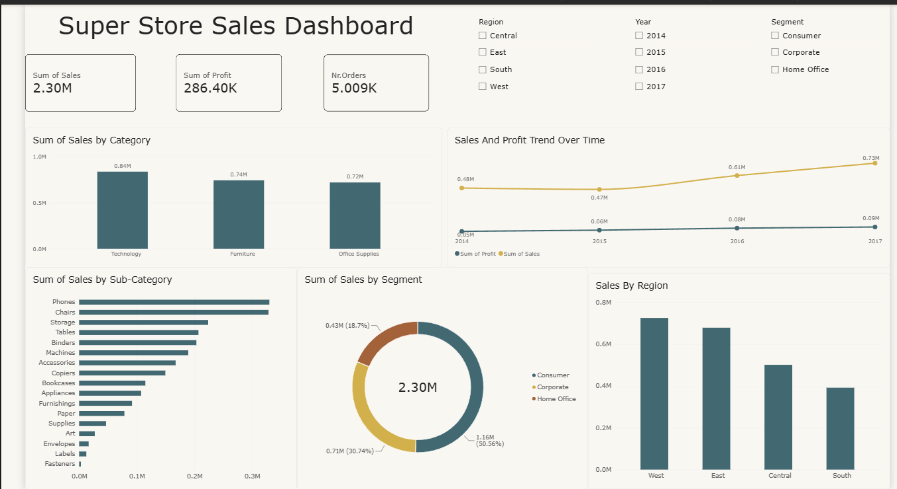

# Power BI Dashboard – Superstore Sales Analysis

## Project Overview
This project presents an interactive Power BI dashboard built using the Sample Superstore dataset. The dashboard provides an overview of sales, profit, orders, and business performance across different categories, regions, customer segments, and years.

## Tools Used
- Power BI Desktop
- Power Query
- DAX

## Dashboard Features
- KPI cards displaying Total Sales, Total Profit, and Total Orders
- Sales trend analysis by year
- Sales comparison across product categories
- Profit analysis by sub-category
- Sales analysis across regions
- Customer segment sales distribution
- Interactive filters for Region, Year, and Sub-Category

## Dashboard Visualizations
1. Sales by Category
2. Sales Trend by Year
3. Profit by Sub-Category
4. Sales by Customer Segment
5. Sales by Region

## Dashboard Screenshot

## Purpose
The objective of this dashboard is to transform sales data into meaningful visual insights and provide an interactive way to explore business performance.

This dashboard helps users understand sales trends, identify profitable product categories, compare regional performance, and analyze customer segments.

---
**Project:** Superstore End-to-End Data Analytics  
**Author:** Jasil Fayad
