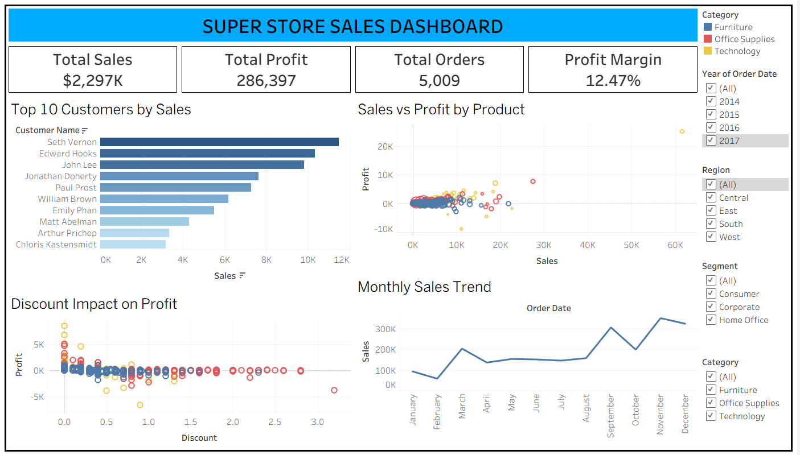

# Tableau Dashboard – Superstore Sales Analysis

## Project Overview
This project presents an interactive Tableau dashboard developed using the Sample Superstore dataset. It focuses on exploring sales performance, profitability, customer behaviour, and the relationship between discounts and profit.

## Tools Used
- Tableau Desktop Public Edition
- Sample Superstore Dataset

## Dashboard Features

### KPI Metrics
- Total Sales
- Total Profit
- Total Orders
- Profit Margin

### Visualizations
1. Top 10 Customers by Sales – Identifies the customers generating the highest sales.
2. Sales vs Profit by Product – Scatter plot showing the relationship between sales and profit.
3. Discount Impact on Profit – Scatter plot exploring how discounts relate to profitability.
4. Monthly Sales Trend – Displays monthly sales patterns throughout the year.

## Interactive Filters
- Year
- Region
- Category
- Segment

These filters allow users to explore business performance across different periods and business segments.

## Dashboard Screenshot

## Project Objective
The objective of this project is to develop an interactive data visualization solution that helps users explore business performance, identify sales patterns, understand profitability, and examine the impact of discounts.

---
**Project:** Superstore End-to-End Data Analytics  
**Author:** Jasil Fayad
